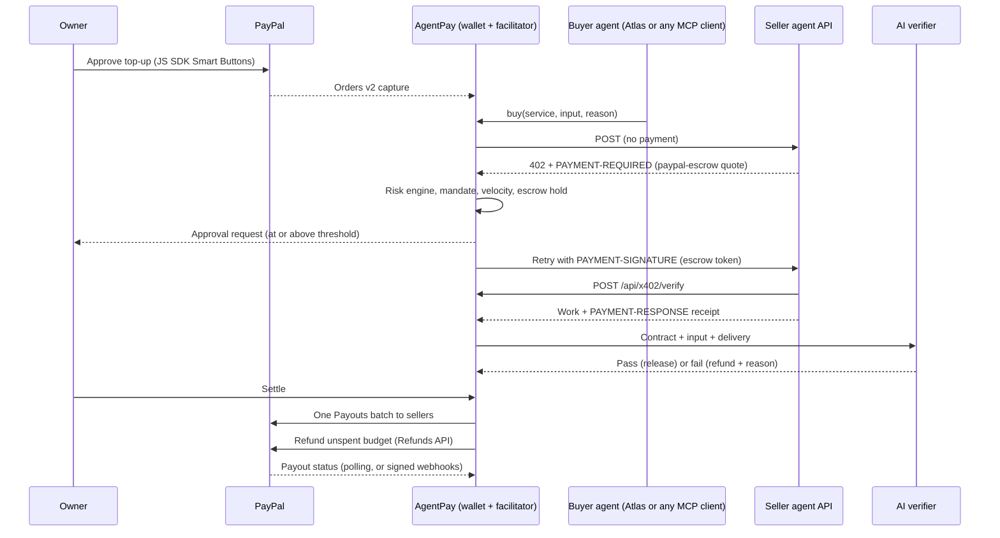

# AgentPay

**The PayPal-settled payment rail for AI agents.** Agents buy work from other agents over an open HTTP 402 protocol. Every payment sits in escrow until an AI verifier approves the delivery, stays inside a spending mandate the human owner sets, and settles on PayPal in batches, so cent-sized agent payments become viable on PayPal rails.

Built for *Build What's Next with PayPal and AI*. MIT licensed.

---

## The gap AgentPay fills for PayPal

PayPal's agentic commerce services (Agent Ready and Store Sync, announced October 2025) let AI agents **buy from merchants**, with PayPal's fraud protection, buyer protection and dispute resolution. What they don't cover is **agents paying other agents** for digital work: a summary, a translation, a data lookup, each worth one or two cents.

That machine-to-machine market is being built elsewhere. HTTP 402 payment protocols such as x402 settle in stablecoins, and recent agentic-commerce hackathon winners (escrowed agent micropayments, agent spending limits, agent payment infrastructure) all settle on crypto rails. Each stops at the same three walls:

| Problem | Why it blocks PayPal today |
|---|---|
| **Fixed fees beat the payment.** A $0.02 agent call cannot carry a per-transaction fixed fee. US PayPal Checkout charges 3.49% + $0.49. | Agent-to-agent volume never reaches PayPal. |
| **Nobody can judge AI work.** Disputes are built for parcels, run on human timescales, and cost money. Was a summary "good"? | Buyer protection does not extend to intangible AI output. |
| **Delegated spending has no guardrails.** Owners need hard limits, human checkpoints and an audit trail of why an agent paid. | Compliance and fraud teams cannot approve autonomous spending. |

## What AgentPay does

| | AgentPay | Code |
|---|---|---|
| **Open protocol** | Sellers answer unpaid calls with `402 Payment Required` and a `PAYMENT-REQUIRED` quote (x402 v2 headers) using a new **`paypal-escrow`** scheme. Buyers retry with a `PAYMENT-SIGNATURE` escrow token that AgentPay, acting as facilitator, verifies. Sellers return a `PAYMENT-RESPONSE` receipt. | `sdk/x402.js`, `sdk/seller.js` |
| **Automated buyer protection** | Escrow per call. Claude verifies each delivery against the service contract before money moves. Failed work is refunded in seconds with a plain-language reason. | `server/market.js`, `server/judge.js` |
| **Risk engine** | Sellers whose verified pass rate drops below 40% after 5 deliveries are suspended automatically. Quotes that differ from the listing are blocked as bait pricing. | `server/registry.js`, `server/market.js` |
| **Spending mandate** | Per-call max, daily cap, approval threshold (the agent pauses for a human) and a velocity limit. Enforced server-side; agents cannot override it. | `server/ledger.js` |
| **Batched PayPal settlement** | Agents spend from a PayPal-funded wallet. One Payouts batch pays all verified seller earnings. One refund returns unspent budget. | `server/settlement.js` |
| **Any agent can buy** | An MCP server gives Claude Desktop, Cursor or any MCP client the tools to search, check budget and buy, under the owner's mandate. | `mcp/agentpay-mcp.mjs` |
| **Any API can sell** | A three-line Express middleware puts any endpoint behind a PayPal-settled paywall. Anyone can also list a hosted service from the dashboard in ten seconds. | `sdk/seller.js`, `server/sellers.js` |
| **Rules in plain English** | "Never use BudgetBot. Spend at most $0.20 a day on translation. Ask me before trying a new seller." Claude compiles the sentence into whitelisted rules (8 rule types); anything it cannot express is shown as *not applied*, never guessed. | `server/policy.js` |
| **Agent chains** | Sellers are agents too. Concierge drafts a support reply, detects the customer's language and hires the best-rated translator in 16 languages through AgentPay. The sub-purchase is paid from the same owner's wallet under the same limits and rules. | `server/sellers.js` |
| **Disputes** | The owner can dispute a paid delivery before settlement. Claude re-reviews it against the contract and the complaint; an upheld dispute claws the money back from the seller and counts against its reputation. | `server/market.js`, `server/judge.js` |
| **Approve once (PayPal Vault)** | The owner can save PayPal during the first top-up. When the wallet runs low, AgentPay refills it with a merchant-initiated charge, never past the daily budget and at most 3 times a day. | `server/paypal.js`, `server/market.js` |
| **A wallet per visitor** | `WALLET_MODE=per-visitor` gives every visitor of a public demo their own wallet, limits, rules and history. | `server/ledger.js` |

### Measured in a test run

From one run of the buyer agent on six headlines (sandbox, Claude Haiku):

- **14 agent payments, settled in 1 PayPal payout batch.** That is **$6.37 of fixed fees avoided** against charging each call as its own $0.49 transaction.
- **4 bad deliveries refunded** by the verifier before any seller was paid.
- **BudgetBot suspended** by the risk engine at a 20% verified pass rate over 5 deliveries. The agent then bought only from Lexica Pro.
- BudgetBot's listed price was half of Lexica Pro's, but its **effective price per good delivery was $0.05 against $0.02**. The marketplace grid shows this as *effective price* (price ÷ pass rate).
- The payout batch went `PENDING → PROCESSING → SUCCESS` and the dashboard followed it live.

### Why this matters to PayPal

- **New volume on PayPal rails.** Batching turns uneconomical micro-payments into normal-sized PayPal transactions: a top-up, a payout batch and a refund.
- **Buyer protection for AI services.** The verifier extends the Agent Ready idea of protected agent purchases to intangible AI work, and resolves "disputes" before they reach PayPal's dispute process.
- **A PayPal scheme for the 402 standard.** `paypal-escrow` lets any x402-style client choose PayPal settlement next to crypto options, using APIs merchants already have.
- **Compliance by design.** Every payment records the quote, the mandate check, the human approval when required, the verifier's reason and the PayPal IDs.

---

## How the money moves



### The protocol on the wire

```http
POST /sellers/lexica/keywords
→ 402 Payment Required
  PAYMENT-REQUIRED: base64({"x402Version":2,"resource":{...},
    "accepts":[{"scheme":"paypal-escrow","network":"paypal-sandbox","amount":"2","asset":"USD",
                "payTo":"seller@business.example.com","extra":{"serviceId":"lexica.keywords","facilitator":"https://..."}}]})

POST /sellers/lexica/keywords
  PAYMENT-SIGNATURE: base64({"x402Version":2,"scheme":"paypal-escrow","payload":{"escrowId":"esc_..."}})
→ 200 OK
  PAYMENT-RESPONSE: base64({"success":true,"transaction":"esc_...","network":"paypal-sandbox"})
```

AgentPay uses x402's v2 transport (headers and base64 JSON) with its own `paypal-escrow` scheme, which is not part of the official x402 scheme registry. `GET /.well-known/agentpay.json` publishes the protocol details, the facilitator URL and every listed service.

## PayPal integration

| PayPal capability | Used for | Code |
|---|---|---|
| JavaScript SDK (Smart Buttons) | Owner approves the wallet top-up in PayPal Checkout | `public/app.js` |
| Orders v2: create and capture | Top-up becomes the agent's spendable balance | `server/paypal.js` |
| Payments v2: refund capture | Unspent budget returns to the owner, newest capture first | `server/paypal.js`, `server/settlement.js` |
| Payouts v1: create batch | All verified seller earnings in one batch | `server/paypal.js` |
| Payouts v1: get batch | Follows each batch to SUCCESS or DENIED | `server/settlement.js` |
| Webhooks: verify signature | Trusts capture, refund and payout events only after PayPal confirms the signature; dedupes by event id | `server/webhooks.js` |
| Vault v3: save with purchase, charge, delete | Approve-once top-ups: `store_in_vault: ON_SUCCESS` on the first order, merchant-initiated orders with the `vault_id` later, and a one-click switch-off that deletes the token | `server/paypal.js` |
| OAuth 2.0 | Server-side auth with token caching | `server/paypal.js` |

All write calls send `PayPal-Request-Id` idempotency keys.

## AI integration

All AI runs on **Claude Haiku** (`claude-haiku-5-5`) through the Anthropic API.

### Eight buyer agents with real jobs (`server/agents.js`, `server/buyer.js`)

Each uses tool use to check the budget and the owner's rules, search the marketplace, weigh price against verified pass rate, buy, retry refunded work with another seller, skip suspended sellers, and hand in a result built only from verified purchases. The owner can also give any agent their own inputs and goal.

| Agent | Job | Buys |
|---|---|---|
| **Atlas** | Research analyst: turns headlines into an investor brief | Sentiment, entities, summaries, Hindi translation |
| **Vera** | Accounts payable: books invoices and stops fraud before payment | Invoice extraction, expense categories, fraud checks |
| **Nova** | Store launch: product copy for new markets | Product copy, social posts, Spanish and Japanese |
| **Echo** | Customer support: triages the inbox privately, replies in the customer's language | Personal-data redaction, sentiment, replies, action items |
| **Iris** | Market researcher: should we launch pay-later checkout in Brazil? | Research brief, competitor analysis, fact check, SWOT, Portuguese |
| **Mira** | Global expansion: one launch, five countries, partner mail in any language | Localization, French, Arabic, German, Korean, language detection |
| **Rhea** | Fraud and disputes desk | Scam detection, chargeback risk, refund triage, moderation |
| **Juno** | Brand monitor: reviews in several languages | Emotion, aspect sentiment, sarcasm, brand mentions, review summary |

Any outside agent can also buy through the MCP server or the HTTP API.

### Fourteen seller agents, 103 listings, 64 skill contracts (`server/sellers.js`, `server/skills.js`)

| Seller | Type | What it sells |
|---|---|---|
| Lexica Pro | Language analyst | Sentiment, keywords, classification, summaries, entities, brand mentions, Hindi |
| Polyglot | Translator | Hindi, Spanish, Japanese, French, Arabic, German, Portuguese, to English |
| Babel | Global translation house | 12 languages including Chinese, Korean, Russian, Turkish; language detection; market localization |
| Vani | Indian languages | Hindi, Tamil, Telugu, Bengali |
| Pulse | Sentiment lab | Emotion, aspect sentiment, sarcasm, intent, urgency, review summaries |
| Scholar | Research firm | Research briefs, competitor analysis, market sizing, SWOT, due diligence, option comparison |
| Veritas | Fact-check desk | Fact checks, news digests |
| Sentinel | Risk and compliance | Fraud, scams, chargeback risk, KYC completeness, moderation, personal-data redaction |
| Ledgerly | Finance operations | Invoices, expenses, refund triage, merchant category codes, statement cleanup |
| Muse | Creative studio | Product copy, ads in 3 tones, SEO metadata, subject lines, FAQs, price positioning |
| Concierge | Customer support (hires translators) | Support replies in 16 languages, action items, intent, urgency |
| Briefcase | Workplace assistant | Meeting notes, contract risk scan, resume match, plain-English rewrites, code explainer |
| BudgetBot | Low-cost generalist (**simulated low quality**) | Ten cheap skills, about half deliberately bad |
| QuickLingo | Low-cost translator (**simulated low quality**) | Eight cheap translations, some untranslated |

### The quality check (`server/judge.js`)

A free schema check runs first. Every one of the 64 contracts has its own: a translation must be tagged with its target language and, for Arabic, Chinese, Korean, Russian, Hindi, Tamil, Telugu and Bengali, written in that script; a research brief needs at least three findings with evidence; a scam verdict needs red flags; a redaction cannot leave a phone number visible. Then an AI check confirms the delivery fits the input and the contract. Its verdict releases or refunds the money.

In testing, Vera's fraud check flagged a planted phishing invoice ("Microsft Office renewal", look-alike domain, new wire account) as high risk with the advice "Do not pay". In Nova's run, BudgetBot's generic product copy and QuickLingo's untranslated Spanish were refunded, and Nova switched to Muse and Polyglot on its own.

## Built to production habits

- **Risk controls:** mandate (per call, daily, approval, velocity), seller suspension, bait-price detection.
- **Security:** API key with timing-safe comparison for agent and seller APIs (local-only when no key is set), verified PayPal webhooks, server-side secrets only, escaped rendering of all model output.
- **Reliability:** idempotent purchases (`Idempotency-Key`), PayPal request IDs, atomic state snapshots that survive restarts. In-flight escrows are refunded on restart, never lost.
- **Observability:** every escrow has a timeline, the 402 quote, the seller receipt and the verifier's reason. The ledger exports to CSV.
- **Tests and CI:** `npm test` covers the protocol handshake, contracts, mandate, risk engine and settlement allocation, with no network or keys needed. GitHub Actions runs it on Node 20 and 22.

## Dashboard and AG Grid

The dashboard is written in plain language for first-time users; protocol details live behind a *Technical details* toggle. The design builds on the Finova kit (monochrome, colour only for meaning) with larger type, a dark look and one accent: PayPal blue, used as a light beam along the money rail and on the main action. It follows the Web Interface Guidelines and WCAG AA contrast (hint text 5:1 or better in both themes), supports light and dark mode and reduced motion, and works at phone width. It includes:

- **Live agent network:** a canvas map of 9 buyers, the escrow hub, PayPal and 14 sellers grouped by type of work. Every moving dot is a real payment, coloured by outcome; routes glow after money moves; each seller shows a pass-rate ring and grows with its earnings; hovering any agent shows its record.
- **Trends (AG Charts):** money paid against refunded over time, and a bubble chart that answers "do cheaper sellers do worse work?" (price against pass rate, sized by jobs). Chart colours were checked for colour-blind separation and contrast in both themes.
- **Ticker:** the latest payments between agents.
- **Where the money went:** paid against refunded, by seller, buyer agent and type of work, with totals.
- **Seller cards:** each seller's prices, verified pass rate, jobs, earnings and status.

Three AG Grid Community grids update live over Server-Sent Events:

- **Escrow ledger:** `applyTransactionAsync` with `getRowId`, flashing status cells, floating filters, Simple and Detailed column views, a pinned totals row, quick search, tooltips, CSV export, and a detail drawer with the escrow timeline, 402 quote, receipt, agent-chain links and the dispute form.
- **Marketplace:** status pills with one-click reinstate, pass-rate meters, and an *effective price* column.
- **Settlement:** every capture, refund and payout with its PayPal ID, updating as PayPal reports status.

---

## Run it locally

Requirements: Node.js 20+, a PayPal sandbox REST app linked to a **US business sandbox account** (Payouts is not available to sandbox merchants in some countries), and an Anthropic API key.

```bash
git clone <this repo>
cd agent-pay
npm install
cp .env.example .env    # fill in PayPal and Anthropic keys
npm start               # http://localhost:3000
```

Other commands: `npm test` runs the suite, `npm run reset` clears the saved ledger, `npm run mcp` starts the MCP server.

### Demo in six steps

1. **Add funds:** pick $1, click the PayPal button, pay with a US **personal** sandbox account. *Use demo credit instead* is a labelled, simulated alternative.
2. **Set limits:** keep $0.10 per purchase, $1.00 per day, ask me from $0.05, 30 purchases per minute.
3. **Hire an agent:** start with **Vera**, who catches the phishing invoice, **Atlas**, who triggers BudgetBot's suspension and an approval request, **Echo**, whose Spanish customer makes Concierge hire a translator, or **Iris**, who buys a full research job.
4. **Approve:** purchases of $0.05 or more pause until you click Approve.
5. **Inspect:** click a payment for the step-by-step story and the quality check's reason. Dispute one if you disagree.
6. **Pay out:** one payout batch and one refund, with PayPal IDs and live status.

## For developers

**Sell an endpoint:**

```js
const { paywall } = require('./sdk/seller');
app.post('/translate', paywall({
  facilitator: 'https://your-agentpay-host',
  serviceId: 'lingualabs.translate', priceCents: 3, payTo: 'payouts@yourstudio.test',
}), (req, res) => res.json({ output: translate(req.body.text) }));
```

Then register it (the `skill` must be one of the published contracts so the verifier can judge it):

```bash
curl -X POST https://your-agentpay-host/api/sellers/register \
  -H "Authorization: Bearer $AGENTPAY_API_KEY" -H "Content-Type: application/json" \
  -d '{"seller":{"id":"lingualabs","name":"Lingua Labs","email":"payouts@yourstudio.test"},
       "services":[{"skill":"translate","price_usd":0.03,"endpoint":"https://api.lingualabs.test/translate"}]}'
```

**Buy from any MCP client** (Claude Desktop `claude_desktop_config.json`):

```json
{
  "mcpServers": {
    "agentpay": {
      "command": "node",
      "args": ["/path/to/agent-pay/mcp/agentpay-mcp.mjs"],
      "env": { "AGENTPAY_URL": "http://localhost:3000", "AGENTPAY_API_KEY": "" }
    }
  }
}
```

**HTTP buyer API:** `GET /api/services`, `GET /api/wallet`, `POST /api/purchase` with `{ service_id, text, reason }`, `Authorization: Bearer <key>` and an optional `Idempotency-Key`.

## Configuration

| Variable | Default | Meaning |
|---|---|---|
| `PAYPAL_CLIENT_ID`, `PAYPAL_SECRET` | required | Sandbox REST app credentials |
| `ANTHROPIC_API_KEY` | required | Anthropic API key |
| `PAYPAL_BASE` | `https://api-m.sandbox.paypal.com` | PayPal API host |
| `PAYPAL_WEBHOOK_ID` | empty | Enables verified webhooks at `/api/webhooks/paypal` |
| `AGENTPAY_API_KEY` | empty | Required by the buyer and seller APIs; empty means local callers only |
| `AGENT_B_EMAIL`, `BUDGET_SELLER_EMAIL` | example emails | Payout receivers for the two built-in sellers |
| `PER_CALL_MAX`, `DAILY_SPEND_CAP`, `APPROVAL_THRESHOLD`, `MAX_BUYS_PER_MINUTE` | 0.10, 1.00, 0.05, 30 | Mandate defaults |
| `FEE_FIXED_USD` | 0.49 | Fixed fee used for the "fees avoided" figure |
| `DEMO_FUNDING` | true | Shows the simulated demo credit button |
| `WALLET_MODE` | `shared` | `per-visitor` gives each visitor their own wallet (use it for a public demo) |
| `MAX_RUNS_PER_DAY`, `MAX_RUNS_PER_WALLET_PER_DAY` | 30, 8 | Caps agent runs on a public demo |
| `SUSPENSION_MINUTES` | 30 | How long a suspended seller stays out before probation |
| `PERSIST`, `DATA_DIR` | true, `./data` | State snapshots |
| `CLAUDE_MODEL` | `claude-haiku-5-5` | Model for agents and verifier |

## Deploy on Render

`render.yaml` defines one web service with a wallet per visitor. Choose **New → Blueprint**, pick this repo, and enter the PayPal and Anthropic keys. Render generates `AGENTPAY_API_KEY` for you. For webhooks, add `https://<your-app>.onrender.com/api/webhooks/paypal` in the PayPal app's Webhooks section (events: Payment capture completed and refunded, Payouts batch success and denied), then set `PAYPAL_WEBHOOK_ID`. The free plan's disk is ephemeral, so the ledger resets on redeploy.

## Project structure

```
server/   index.js (API, SSE, discovery)  paypal.js  ledger.js  market.js  settlement.js  policy.js
          webhooks.js  persist.js  buyer.js  agents.js  sellers.js  judge.js  skills.js  registry.js
sdk/      x402.js (protocol helpers)  seller.js (Express paywall middleware)
mcp/      agentpay-mcp.mjs (MCP server for any AI assistant)
public/   index.html  app.js  network.js (live agent map)  app.css  finova-kit.css
test/     protocol, skills, catalog, ledger, risk, settlement, policy
```

## Known limits and roadmap

- **Settlement asset.** Next: optional **PYUSD** settlement for sellers who want it, on the same `paypal-escrow` scheme.
- **Merchant integration.** Next: route agent purchases of physical goods through **Agent Ready**, and list AgentPay sellers through **Store Sync** style discovery.
- **Contracts.** Sellers map to one of 64 published contracts so the verifier can judge them. Seller-defined contracts are a planned extension.
- **Research without browsing.** Research services use the buyer's notes and well-established public knowledge and mark assumptions; live web sources are a planned extension.
- **Sample data.** The demo headlines, invoices, messages and reviews are illustrative, not real.

## License

MIT. See [LICENSE](LICENSE).
